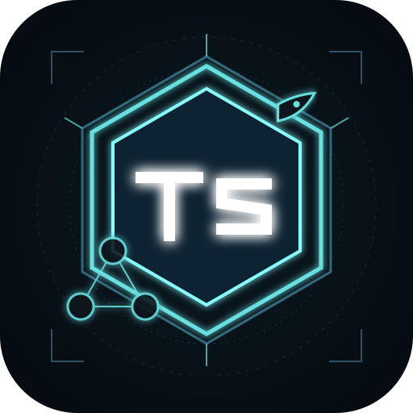
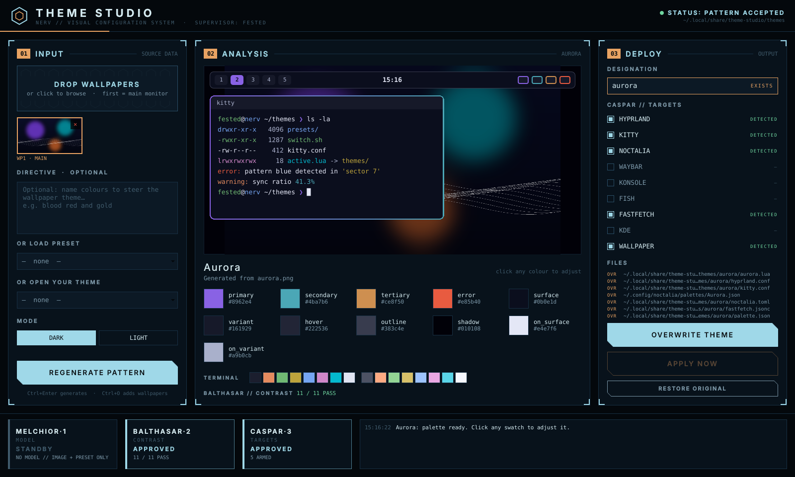
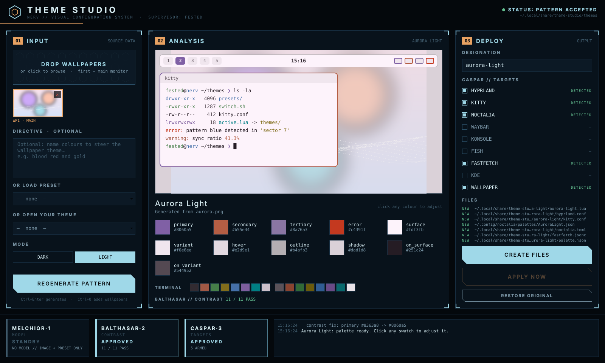
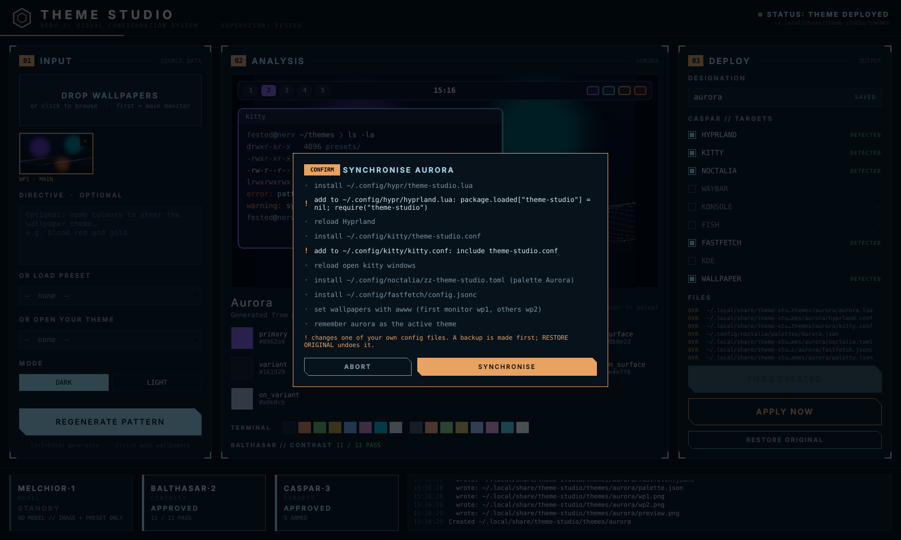

<p align="center"></p>

# Theme Studio

Make desktop themes for **Hyprland** and **KDE Plasma** from a wallpaper, a text
prompt, or a preset, in a NERV-style window. Every theme is previewed first, every
change to your configs is listed before it happens, and one button puts everything
back the way it was.

<p align="center"></p>

<p align="center">
  
  
</p>

- **From a wallpaper**: colours are measured from the picture (no AI needed); the same
  image always gives the same theme. Two wallpapers = one per monitor.
- **From a directive**: "Unit-01: deep purple, lime green, orange" — a local model
  (Ollama) or any OpenAI-compatible API picks the mood; the colours you name are kept.
- **Dark or light**, contrast-checked (WCAG) with one-click auto-fix.
- **Edit a finished theme**: open it, click a swatch, overwrite.
- **Targets**: Hyprland (Lua 0.55+ and classic conf), kitty, Noctalia, waybar, Konsole,
  fish, fastfetch, KDE colour scheme, wallpapers per monitor. Detected automatically.
- **Safe**: backups before the first change to any of your files, one marked line per
  config at most, and RESTORE ORIGINAL / `theme-studio unhook` to undo it all.

## Install

**Arch / CachyOS / EndeavourOS** — build the package with `makepkg` (the AUR package
follows once AUR registration reopens). This installs the app, its launcher entry and
icon, and pulls PySide6 and Pillow from the Arch repos:

```bash
git clone https://github.com/tunnelpojken/theme-studio
cd theme-studio/packaging/aur
makepkg -si
```

Or download the ready-made `.pkg.tar.zst` from
[Releases](https://github.com/tunnelpojken/theme-studio/releases) and run
`sudo pacman -U theme-studio-*.pkg.tar.zst`.

**Windows 11:** download `ThemeStudio-<version>-setup.exe` from
[Releases](https://github.com/tunnelpojken/theme-studio/releases) and run it (no admin
needed). Windows may say "Windows protected your PC": the app isn't code-signed yet, so
click **More info → Run anyway**. A portable `.zip` is there too. On Windows a theme sets
dark/light mode, the accent colour (Start, taskbar, title bars), the wallpaper, Windows
Terminal's colours and an entry under Settings → Personalisation → Themes; RESTORE
ORIGINAL puts it all back. Building it yourself: `packaging/windows/build.ps1`.

**Any distro with Python 3.11+** (pipx):

```bash
pipx install "theme-studio[gui] @ git+https://github.com/tunnelpojken/theme-studio"
```

**From a clone, for development:**

```bash
git clone https://github.com/tunnelpojken/theme-studio
cd theme-studio
pipx install '.[gui]' --force   # Arch: sudo pacman -S python-pipx; PySide6 is ~150 MB, once
theme-studio init               # optional: writes ~/.config/theme-studio/config.toml
```

## The window

```bash
theme-studio gui                 # or: theme-studio-gui, or the "Theme Studio" app entry
```

Drop wallpapers (or Ctrl+O) for an instant theme, or write a directive alone to have
MAGI design one, or pick a preset. Then
**GENERATE PATTERN** (Ctrl+Enter). MODE switches between a dark and a light theme. Click any swatch to adjust it, **AUTO-FIX** if
BALTHASAR flags contrast, then **CREATE FILES** and **APPLY NOW**. Apply lists every
change first; lines marked `!` touch your own configs. **RESTORE ORIGINAL** undoes
everything Theme Studio applied (the same as `theme-studio unhook`); your themes stay.

The MAGI bar: MELCHIOR = model connection (click to re-test), BALTHASAR = contrast,
CASPAR = targets. Fonts: Orbitron + Share Tech Mono if installed, fallbacks otherwise.

Launcher entry and icon for a pipx install (the AUR package does this for you):

```bash
cp theme-studio.desktop ~/.local/share/applications/
sed -i "s|^Exec=.*|Exec=$HOME/.local/bin/theme-studio-gui|" ~/.local/share/applications/theme-studio.desktop
mkdir -p ~/.local/share/icons/hicolor/scalable/apps
cp theme_studio/gui/theme-studio.svg ~/.local/share/icons/hicolor/scalable/apps/
```

The `sed` line matters on Hyprland: launchers started by the compositor don't read
your shell's PATH, so they wouldn't find `~/.local/bin` otherwise.
On Hyprland, float it at a good size:

```lua
-- hyprland.lua (or windowrule = float, class:theme-studio in hyprland.conf)
-- class: theme-studio   size 1480x920   centred
```

## Make themes (command line)

```bash
theme-studio preview --image wp1.png                    # look only, writes nothing
theme-studio make --image wp1.png wp2.png --name city   # wp1 = main monitor
theme-studio make --image city.png --accent '#ff8a3d'   # pick the accent yourself
theme-studio make --prompt "Blade Runner, orange haze and teal"     # needs a model
theme-studio make --image city.png --prompt "blood red and gold"   # wallpaper + named colours (no model)
theme-studio make --image city.png --ai                 # opt-in: model assigns roles from the image
theme-studio make --preset nord
theme-studio make --image pastel.png --light            # light theme: pale background, dark text
theme-studio make ... --apply                           # switch to it right away
```

Wallpapers never need a model: their colours are measured, and the same image always
gives the same theme. Colours named in a directive steer the accents. A directive on
its own (no wallpaper) is where the model comes in.

## Switch themes

```bash
theme-studio apply city      # lists every change, asks, then does it
theme-studio unhook          # undo everything apply ever changed
```

If `~/.config/themes/switch.sh` exists, `apply` runs it and only handles the
apps it doesn't cover (set `[apply] command` / `command_handles` to change that).

## Targets

Auto-detected; override with `--targets kitty,fish` or `--targets all`.

| Target | Theme folder | `apply` installs | Your config gets |
| --- | --- | --- | --- |
| hyprland | `<name>.lua`, `hyprland.conf` | `~/.config/hypr/theme-studio.{lua,conf}` | one `source`/`require` line |
| kitty | `kitty.conf` | `~/.config/kitty/theme-studio.conf` | `include theme-studio.conf` |
| noctalia | `noctalia.toml` + palette JSON | `~/.config/noctalia/zz-theme-studio.toml` | nothing (V5 merges *.toml) |
| waybar | `waybar.css` | `~/.config/waybar/theme-studio.css` | `@import "theme-studio.css";` |
| konsole | `<Palette>.colorscheme` | `~/.local/share/konsole/` | `ColorScheme=` on the default profile |
| fish | `theme.fish` | `~/.config/fish/conf.d/theme-studio.fish` | nothing |
| fastfetch | `fastfetch.jsonc` | `~/.config/fastfetch/config.jsonc` (only if you have no config of your own) | nothing |
| kde | `<Palette>.colors` | `~/.local/share/color-schemes/` + `plasma-apply-colorscheme` | nothing |
| wallpaper | `wp1.png`, `wp2.png` | awww / swww / hyprpaper per monitor | nothing |

`kde` is only detected inside a Plasma session and `wallpaper` inside Hyprland.
Every user file is backed up to `~/.local/share/theme-studio/backups/` before
its first change. waybar colours appear where your `style.css` uses them, e.g.
`background: @ts_surface;` (also `@background`, `@accent`, `@red` ...).

## Model backend (optional)

```toml
# ~/.config/theme-studio/config.toml
[backend]
kind = "ollama"                  # or "api", or "none"
url = "http://localhost:11434"   # api: an OpenAI-compatible URL ending in /v1
model = "qwen3:8b"
api_key_env = ""                 # api: name of the env var with the key
keep_alive = "0"                 # unload the model after each theme
```

`theme-studio backend` tests the connection. Ollama on Arch:
`sudo pacman -S ollama-cuda && sudo systemctl start ollama && ollama pull qwen3:8b`.
API keys can also come from the keyring: `secret-tool store --label theme-studio service theme-studio`.

## Other commands

```bash
theme-studio list            # presets, your themes, detected targets
theme-studio check city      # contrast report
theme-studio remove city     # asks first
```

## Notes

- **Hyprland 0.55+ (Lua config)**: border colours are set with
  `hl.config({ general = { col = { active_border = { colors = {...}, angle = 45 } } } })`.
  If Noctalia's Hyprland colour template is enabled, Noctalia sets the borders instead.
- **Noctalia**: Theme Studio adds `~/.config/noctalia/zz-theme-studio.toml` (loads last)
  and reloads Noctalia; your own config is never edited.
- **Your own switcher**: if `~/.config/themes/switch.sh` exists, `apply` runs it first and
  only handles the targets it doesn't cover (`[apply] command`, `command_handles`).

## License

MIT, see [LICENSE](LICENSE). The bundled presets are colour palettes inspired by the
themes they're named after; no artwork is included.
